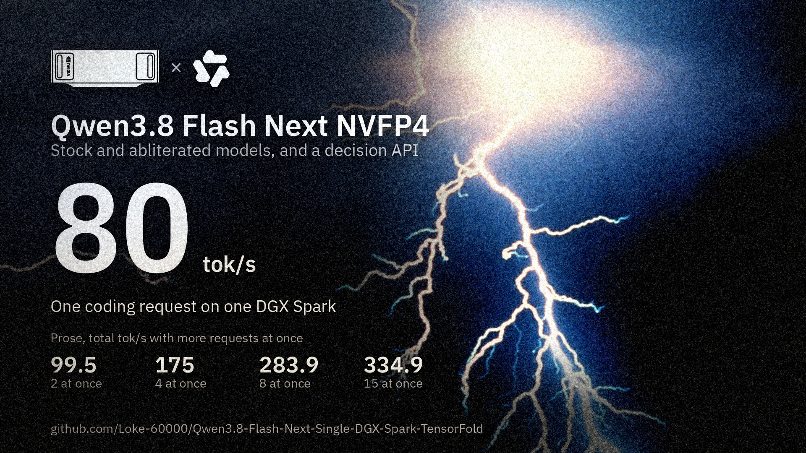
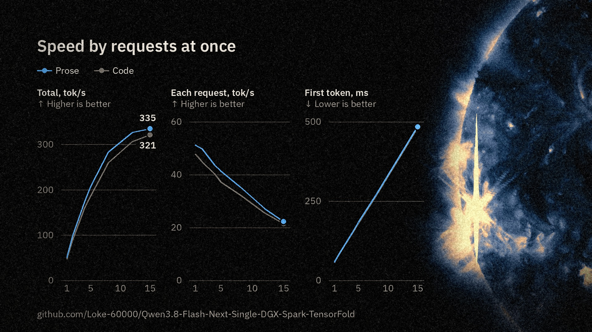
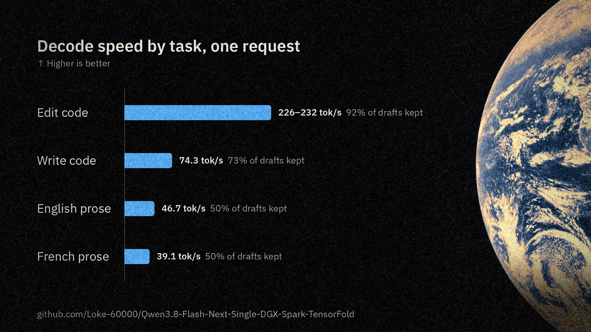
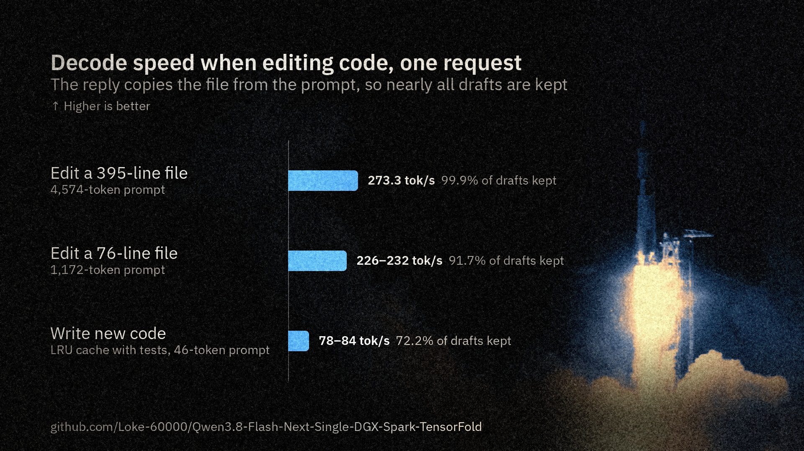
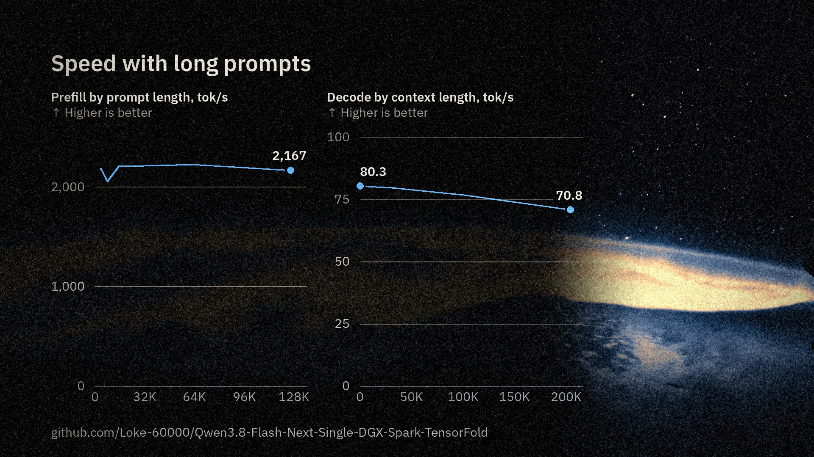
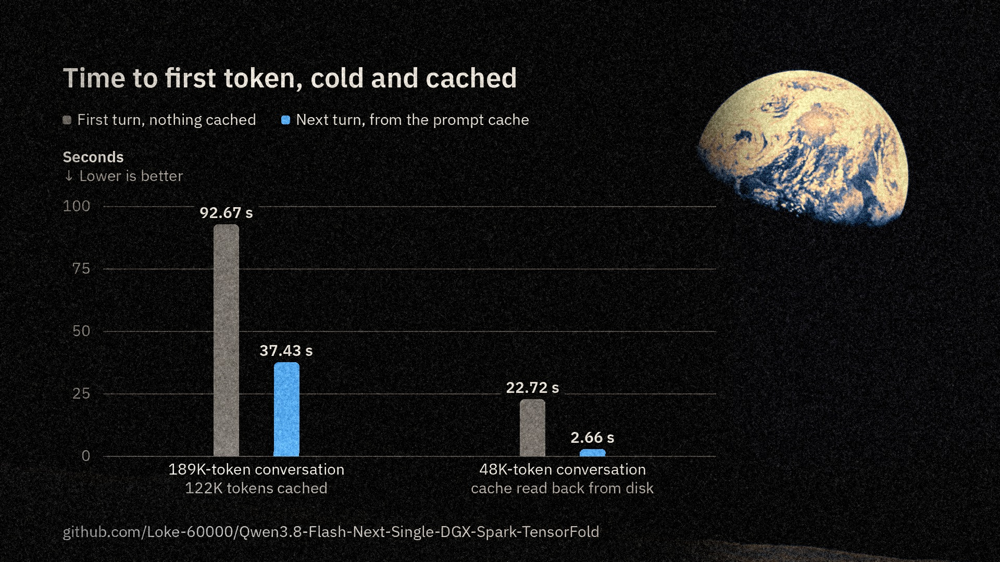
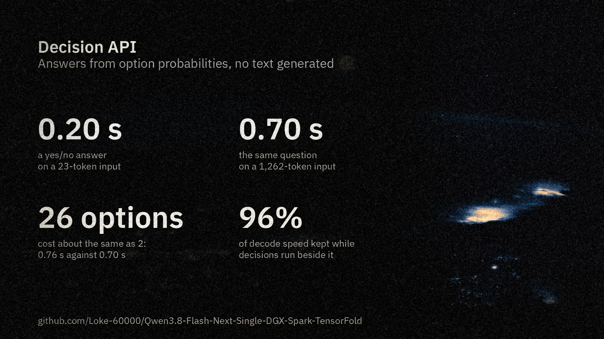
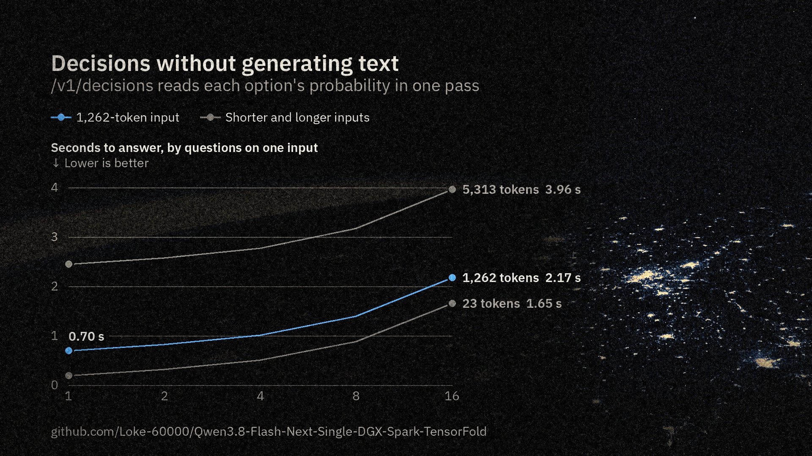
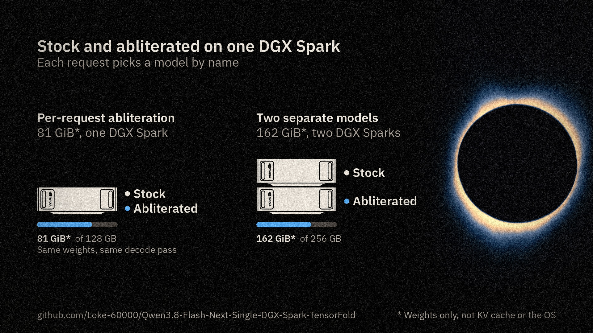

<p align="center">
  
</p>

# Qwen3.8 Flash Next on one DGX Spark

Serves Qwen3.8 Flash Next on a single DGX Spark with TensorFold's Zig engine, through an OpenAI-compatible API on port
8888. One server holds one copy of NVIDIA's FP4 checkpoint and answers three kinds of model id:

- **The stock model** (`Qwen3.8-Flash-Next` by default) for chat, tool calls, reasoning, and image, video and PDF input.
- **Abliterated variants**, picked per request by model name (`Qwen3.8-Flash-Next-abliterated` with `ABLIT=2`). No second
  copy of the weights.
- **Decision ids** (`Qwen3.8-Flash-Next-decision`, ...) that give choice, score and yes/no answers read from the model's own
  probabilities, without generating text.

This branch, `main-gl`, is a fork of [MiaAI-Lab's recipe](https://github.com/MiaAI-Lab/Qwen3.8-Flash-Next-Single-DGX-Spark-TensorFold).
It adds per-request abliteration, long-conversation caching, a disk tier for prompt states, faster French and German
drafting and the decision API. None of them changes the weights. The stock model's replies stay the same token for
token, and an abliterated id only changes its own requests. MiaAI-Lab's README, with the
full recipe reference, is [README-upstream.md](README-upstream.md). AI agents deploying it should read [README-agents.md](README-agents.md).

## Speed

All numbers are from one DGX Spark (GB10, 128 GB) with this branch. The server takes up to 15 requests at once,
keeps keys in fp8 and values in NVFP4 in the KV cache, and drafts with MTP. Replies are greedy.



<details>
<summary>Exact numbers</summary>

Each request decodes 256 tokens from a short prompt, median of 3 runs. Thinking is on, so "code" includes the model's
reasoning prose. Total is the sum of the requests' decode speeds.

| Requests at once | Prose, total tok/s | Prose, each request | Prose, first token | Code, total tok/s | Code, each request | Code, first token |
| ---: | ---: | ---: | ---: | ---: | ---: | ---: |
| 1 | 51.1 | 51.1 | 59 ms | 47.6 | 47.6 | 58 ms |
| 2 | 99.5 | 49.8 | 90 ms | 89.8 | 44.9 | 89 ms |
| 4 | 175.0 | 43.7 | 151 ms | 161.0 | 40.3 | 149 ms |
| 5 | 206.9 | 41.4 | 183 ms | 186.4 | 37.3 | 179 ms |
| 8 | 283.9 | 35.5 | 270 ms | 260.0 | 32.5 | 267 ms |
| 12 | 326.7 | 27.2 | 393 ms | 306.1 | 25.5 | 389 ms |
| 15 | 334.9 | 22.3 | 484 ms | 321.3 | 21.4 | 481 ms |

</details>

What one request decodes depends on the task. MTP drafting pays when the model's next tokens are easy to guess:



<details>
<summary>Exact numbers</summary>

One request, 400 tokens, thinking off (`tools/vocab_bench.py`; code editing from section below).

| Task | Decode tok/s | Drafts kept |
| --- | ---: | ---: |
| Edit code | 226-232 | 92% |
| Write code | 74.3 | 73% |
| English prose | 46.7 | 50% |
| French prose | 39.1 | 50% |
| German prose | 43.8 | 51% |

</details>

Editing code is the fastest case. The reply copies most of the file from the prompt, the engine drafts those tokens
straight from it, and nearly every draft is kept:



<details>
<summary>Exact numbers</summary>

| Task | Prompt tokens | Output tokens | Decode tok/s | Drafts kept |
| --- | ---: | ---: | ---: | ---: |
| Rename a function in a 395-line file, whole file out | 4,574 | 1,500 | 273.3 | 99.9% |
| Rename a function in a 76-line file, whole file out | 1,172 | 1,125 | 226-232 | 91.7% |
| Write an LRU cache class with tests | 46 | 494 | 78-84 | 72.2% |

</details>

## Long prompts and conversations

The window is 262,144 tokens. Prefill runs at about 2,200 tok/s whatever the length, and decode loses 12% from an empty
context to 204K tokens:



<details>
<summary>Exact numbers</summary>

| Prompt tokens | Prefill seconds | Prefill tok/s |
| ---: | ---: | ---: |
| 4,003 | 1.82 | 2,178 |
| 7,928 | 3.84 | 2,053 |
| 15,769 | 7.12 | 2,207 |
| 31,489 | 14.20 | 2,215 |
| 62,914 | 28.26 | 2,225 |
| 125,723 | 58.01 | 2,167 |

| Context tokens | Decode tok/s | Time to first token (cold) |
| ---: | ---: | ---: |
| 46 | 80.3 | 0.26 s |
| 31,570 | 79.6 | 13.22 s |
| 100,924 | 76.8 | 44.51 s |
| 204,263 | 70.8 | 103.35 s |

</details>

A conversation's next turn resumes from the prompt cache instead of reading its whole history again. Three things keep
long agent sessions cached:

- **The prompt cache** (`PROMPT_CACHE_GIB`) keeps whole states of recent conversations in memory, about 16 KiB a token.
- **Partial keep** (`TENSORFOLD_PROMPT_CACHE_PARTIAL=1`, patch `0013`) lets a conversation longer than the cache keep
  the furthest state that fits, so its next turn reads only the rest.
- **The disk tier** (`SPILL_GIB`, patch `0012`) writes a state pushed out of memory to the SSD and reads it back when its
  conversation returns.



<details>
<summary>Exact numbers</summary>

| Case | Prompt tokens | Cached tokens | Time to first token |
| --- | ---: | ---: | ---: |
| 189K conversation, first turn | 189,201 | 0 | 92.67 s |
| 189K conversation, next turn (partial keep) | 189,248 | 122,368 | 37.43 s |
| 48K conversation, first turn | 48,422 | 0 | 22.72 s |
| 48K conversation, back from the disk tier | 48,422 | 48,415 | 2.66 s |

With a 2.1 GiB prompt cache. With a 3.6 GiB cache a 122K conversation's next turn takes 0.31 s, but that needs memory the
lab's Spark keeps for other services.

</details>

[docs/long-conversations.md](docs/long-conversations.md) explains how the disk tier spares the SSD, and lists its settings.

## Decision API

A decision id answers choice, score and yes/no questions about an input. The model generates no text. It reads the
probability of each option's label after one pass over the prompt. A request's questions share one read of the input,
then each question costs only its own few tokens.





<details>
<summary>Exact numbers</summary>

`tools/decision_latency.py`, median of 3, server idle. `input_tokens` counts the input text alone.

| Input tokens | 1 question | 2 | 4 | 8 | 16 |
| ---: | ---: | ---: | ---: | ---: | ---: |
| 23 | 0.20 s | 0.32 s | 0.51 s | 0.89 s | 1.65 s |
| 283 | 0.33 s | 0.46 s | 0.65 s | 1.03 s | 1.80 s |
| 1,262 | 0.70 s | 0.82 s | 1.02 s | 1.40 s | 2.17 s |
| 5,313 | 2.45 s | 2.58 s | 2.78 s | 3.18 s | 3.96 s |

| Options in one choice question (1,262-token input) | 2 | 3 | 5 | 10 | 26 |
| --- | ---: | ---: | ---: | ---: | ---: |
| Seconds | 0.71 | 0.71 | 0.72 | 0.72 | 0.76 |

A request decoding 75.7 tok/s alone keeps 72.4 tok/s while decisions arrive back to back beside it. Decisions wait longer then.
A 1-question decision on a 283-token input takes 4.4 s instead of 0.33 s, and on a 5,313-token input 36.5 s instead of
2.45 s. `TENSORFOLD_DECISION_SHARE` sets that balance, see [docs/decision-api.md](docs/decision-api.md#under-load).

</details>

Turn decision ids on with one line in `.env`, then restart:

```bash
TENSORFOLD_DECISION_IDS=Qwen3.8-Flash-Next-decision=Qwen3.8-Flash-Next
```

Request shapes, examples for both endpoints and the load settings are in [docs/decision-api.md](docs/decision-api.md).

## Per-request abliteration



`ABLIT=2` serves the stock model and an abliterated one from the same weights. The abliterated id,
`Qwen3.8-Flash-Next-abliterated`, applies house-qsa refusal directions to each of its requests' rows (patches `0006` to
`0008`); requests to the stock id are untouched.

```bash
ABLIT=2 ./start.sh restart
```

The abliterated model has had its safety refusals removed. Read the directions' model card before serving it.
`ABLIT=1`, which grafts an abliteration overlay into the checkpoint instead, is described in
[README-upstream.md](README-upstream.md#ablit-opt-in).

Your own abliterated ids, directions files and how it works are in [docs/ablation.md](docs/ablation.md).

## Requirements

- A DGX Spark (or another GB10 system with 128 GB unified memory) with nothing else large on the GPU. `start.sh` needs
  about 107 GiB of `MemAvailable` at start and stops below that.
- Docker with the NVIDIA container runtime, and your user in the `docker` group.
- About 160 GB of free disk on a fresh machine, for the checkpoint (about 96 GiB, under `~/.cache/huggingface`), the image
  and room to keep 100 GB free. The disk tier, when on, keeps `SPILL_MIN_FREE_GIB` free on top.
- A Hugging Face token (`HF_TOKEN` or `hf auth login`) is optional. The checkpoint is public, but `ABLIT=1` needs a token.

## Quick start

```bash
git clone https://github.com/Loke-60000/Qwen3.8-Flash-Next-Single-DGX-Spark-TensorFold.git
cd Qwen3.8-Flash-Next-Single-DGX-Spark-TensorFold
./start.sh
```

The first run builds the image (TensorFold v1.2.7 plus `patches/0001` to `0017`) and downloads the checkpoint (about 96
GiB). Later starts only load the weights. `start.sh` prints `Qwen3.8-Flash-Next is now LIVE! on
port 8888` once a smoke test passes.

```bash
curl -s http://<spark-address>:8888/v1/models
curl -s http://<spark-address>:8888/v1/chat/completions -H 'Content-Type: application/json' -d '{
  "model": "Qwen3.8-Flash-Next",
  "messages": [{"role": "user", "content": "Write a Python fibonacci function."}],
  "max_tokens": 1000}'
```

Any OpenAI client works with `base_url = "http://<spark-address>:8888/v1"`. The model thinks before it answers, so give
replies enough `max_tokens`.

```bash
./start.sh restart        # after changing .env
./stop.sh
docker logs -f qwen38-flash-next-tf
```

## Configuration

Settings go in `.env` beside `start.sh` (`KEY=value` lines, read, never run). This branch's settings and the ones the
benchmarks ran with are in [docs/configuration.md](docs/configuration.md). MiaAI-Lab's settings (window, sampling, vision,
video, PDF, KV format) are in [README-upstream.md](README-upstream.md#configuration).

## Patches

`scripts/prepare.sh` applies these on top of TensorFold v1.2.7 (`93a2e93e`). If you'd rather read them as commits,
they're on [tensorfold-gl](https://github.com/Loke-60000/tensorfold-gl/tree/ablation-127), branch `ablation-127`.

| Patch | What it does | By |
| --- | --- | --- |
| `0001`, `0002` | NVIDIA's quantized vision tower; an image budget of 16,384 tokens | MiaAI-Lab |
| `0003` | `--kv-cache fp8` for Flash Next | MiaAI-Lab |
| `0004` | an MXFP8 prompt tile, for 7 to 9% faster prefill | MiaAI-Lab |
| `0005` | video input on the CUDA engine | chai-md, rebased by MiaAI-Lab |
| `0006` to `0008` | per-request abliteration and identities | Loke-60000 |
| `0009` to `0011` | fp8 and NVFP4 KV rows on the shared page pool | Loke-60000 |
| `0012` | `TENSORFOLD_ROWS_MIN_TOKENS` for the disk tier | Loke-60000 |
| `0013` | partial keep for conversations past the cache | Loke-60000 |
| `0014` | `TF_FLASHNEXT_DRAFT_VOCAB`, a draft vocabulary per language | Loke-60000 |
| `0015` | decisions run in steps beside decoding requests, through an identity | Loke-60000 |
| `0016` | `TENSORFOLD_DECISION_IDS`, decision model ids | Loke-60000 |
| `0017` | a decision's questions read their shared input once | Loke-60000 |

Tested with `tools/exact.py`, `tools/toolcheck.py`, `tools/disk_check.py` and the engine's host tests. Drafted replies,
concurrent replies and replies resumed from disk all match a plain one-at-a-time reply. Applied to `93a2e93e`, the
patches give back exactly the tree that was tested.

## License

MIT for this repository's scripts, see [LICENSE](LICENSE). The model weights aren't part of this repository. NVIDIA's
FP4 checkpoint is under the [NVIDIA Open Model Agreement](https://www.nvidia.com/en-us/agreements/enterprise-software/nvidia-open-model-agreement/),
and its base model, Qwen3.8 Flash Next, under the Qwen Community License 1.0. The image is built on NVIDIA's PyTorch
container, whose software is under NVIDIA's own license terms, printed at every start. TensorFold and the patches to it
are under TensorFold's licenses.

## Credits

- **Recipe:** [MiaAI-Lab](https://github.com/MiaAI-Lab) (Mia's AI Lab), whose
  [Qwen3.8-Flash-Next-Single-DGX-Spark-TensorFold](https://github.com/MiaAI-Lab/Qwen3.8-Flash-Next-Single-DGX-Spark-TensorFold)
  this branch builds on, with patches `0001` to `0005`. Everything credited in [CREDITS.md](CREDITS.md) applies here.
- **Engine:** [TensorFold](https://github.com/ashhart/TensorFold) v1.2.7 by Ash Hart ([ashhart](https://github.com/ashhart))
  and the TensorFold contributors, including the Flash Next CUDA engine, the prompt cache and its disk tier, the
  `/v1/decisions` and `/v1/systemone` routes and MTP drafting. The Zig CUDA serving path is by Jürgen Schmied
  ([jschmied](https://github.com/jschmied)).
- **Video input (patch `0005`):** [chai-md](https://github.com/chai-md).
- **French and German draft lists:** from MiaAI-Lab's `lang-draft-vocabs` branch, which took them from the language draft
  vocabularies by Javier ([jvr0x](https://github.com/jvr0x)).
- **Abliteration:** the "house-qsa" abliteration is [drowzeys](https://huggingface.co/drowzeys)'s Keys overlay
  ([drowzeys/keys-Qwen3.8-Flash-Next-NVFP4-FP4-QAD-house-qsa-L3-47](https://huggingface.co/drowzeys/keys-Qwen3.8-Flash-Next-NVFP4-FP4-QAD-house-qsa-L3-47));
  `ABLIT=2` serves it per request as directions
  ([Loke-60000/Qwen3.8-Flash-Next-FP4-Local-house-qsa-directions](https://huggingface.co/Loke-60000/Qwen3.8-Flash-Next-FP4-Local-house-qsa-directions)).
- **Model:** [Qwen3.8 Flash Next](https://huggingface.co/Qwen/Qwen3.8-Flash-Next) by the Qwen team (Alibaba).
- **Checkpoint:** NVIDIA's [FP4 QAD export](https://huggingface.co/nvidia/Qwen3.8-Flash-Next-FP4-Local) (Model Optimizer).
- **Lab patches `0006` to `0017`, benchmarks and this README:** Loke-60000.
- **Card photos:** public domain, from NASA (Apollo 8, Apollo 17, the International Space Station, the Solar Dynamics
  Observatory and Armstrong Flight Research Center) and NOAA, through Wikimedia Commons.
- **Card typeface:** [IBM Plex Sans](https://github.com/IBM/plex), SIL Open Font License.
- **DGX Spark drawing on the cards:** by Loke-60000, not published separately. NVIDIA, DGX Spark and Qwen are trademarks of
  their owners.
